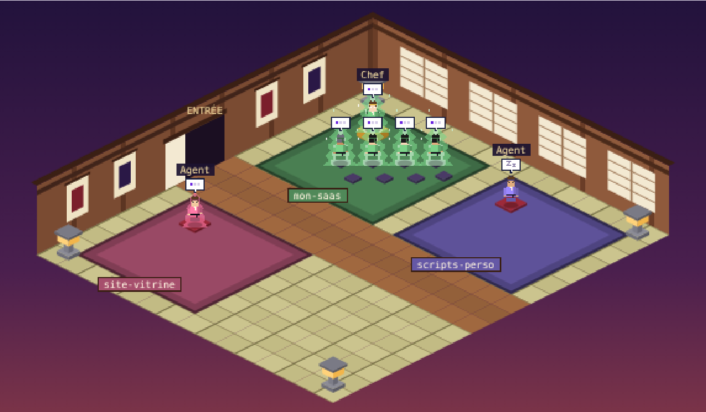

# Dojo Claude Code

Un dojo en pixel art où tu vois tes sessions Claude Code travailler en direct.



Chaque projet ouvert dans Claude Code a son tapis. Quand une session lance des sous-agents, elle devient chef : elle s'installe au fond du tapis sur une estrade dorée, et ses sous-agents entrent par la porte, s'assoient devant elle le temps de leur tâche, puis repartent. Une session qui travaille seule reste un agent solo.

## Ce que tu vois

- **Un tapis par session**, à la couleur du projet, avec son nom sur une plaque (8 tapis maximum).
- **Le chef** (cape, ceinture et bandeau dorés) et **ses sous-agents**, nommés d'après leur type : `Explore`, `code-reviewer`, ou tes agents personnalisés.
- **L'état de chaque agent** : bulle « … » quand il travaille, « zZ » quand il attend ta réponse.
- **Une aura selon le modèle** de la session : aucune pour Haiku, légère pour Sonnet, grande pour Opus, maximale pour Mythos et Fable.
- **Des notifications et un journal** : nouvelle session, sous-agent envoyé avec sa tâche, sous-agent qui a fini, session terminée.
- **Une fiche par agent** en cliquant dessus : projet, modèle, dernière demande, tâche en cours.
- **Une icône dans la barre des menus** avec le nombre d'agents au travail, pour ouvrir, arrêter ou quitter le dojo.

## Prérequis

- macOS 12 ou plus récent
- [Node.js](https://nodejs.org) 18 ou plus récent (vérifie avec `node -v`)
- [Claude Code](https://docs.claude.com/en/docs/claude-code/overview)
- Pour l'icône de la barre des menus : les outils de développement d'Apple (`xcode-select --install`). Sans eux, le dojo fonctionne quand même, juste sans icône.

## Installation

```bash
git clone https://github.com/Juan-Garcia-Rodriguez/claude-dojo.git
cd claude-dojo
node install.js
```

Le dojo s'ouvre dans ton navigateur sur **http://localhost:4747**, et son icône apparaît dans la barre des menus. Relance ensuite tes sessions Claude Code : celles qui étaient déjà ouvertes ne prennent pas les nouveaux hooks.

Pour mettre à jour, fais `git pull` puis relance `node install.js`.

## Comment ça marche

```
Claude Code ──hooks──▶ ~/.claude-dojo/events.jsonl ──▶ serveur local ──▶ http://localhost:4747
```

1. L'installeur ajoute des [hooks](https://docs.claude.com/en/docs/claude-code/hooks) dans `~/.claude/settings.json`. À chaque événement utile (début et fin de session, demande envoyée, sous-agent lancé ou terminé), `hook.js` ajoute une ligne au journal `~/.claude-dojo/events.jsonl`. Il ne bloque jamais Claude Code et n'écrit rien dans sa sortie.
2. `state.js` relit ce journal et en déduit l'état de chaque session : projet, statut, modèle, rôle (chef ou solo) et sous-agents actifs.
3. `web.js` sert la page du dojo et l'état sur `127.0.0.1:4747`. La page se met à jour toutes les 2 secondes.
4. L'appli « Dojo Claude Code » (`DojoMenu.swift`, compilée sur ta machine et rangée dans `~/Applications`) affiche l'icône de la barre des menus et démarre le serveur web. Elle se lance à l'ouverture de session grâce à launchd.
5. En bonus, `server.js` ajoute un petit serveur MCP « claude-dojo » à l'appli Claude desktop. Il expose l'outil `dojo_state`, qui permet à Claude de savoir ce que font tes agents quand tu lui poses la question.

### Fichiers modifiés par l'installeur

Une copie de sauvegarde (`.avant-dojo.bak`) est faite avant toute modification.

| Fichier | Rôle |
|---|---|
| `~/.claude/settings.json` | Hooks Claude Code |
| `~/Library/Application Support/Claude/claude_desktop_config.json` | Serveur MCP pour l'appli Claude desktop |
| `~/Library/LaunchAgents/com.claude-dojo.web.plist` | Lancement au démarrage |
| `~/Applications/Dojo Claude Code.app` | Icône de la barre des menus |
| `~/.claude-dojo/` | Scripts, journal et logs |

## Confidentialité

Tout reste sur ta machine. Le serveur n'écoute que sur `127.0.0.1` : personne d'autre sur ton réseau ne peut voir le dojo. Le journal garde les 240 premiers caractères de chaque demande, pour l'afficher dans la fiche du chef. Pour ne pas les enregistrer, ajoute `DOJO_NO_PROMPTS=1 ` au début de la commande des hooks dans `~/.claude/settings.json`.

## Utilisation au quotidien

- **Ouvrir le dojo :** icône de la barre des menus, puis « Ouvrir le dojo », ou directement http://localhost:4747.
- **Arrêter ou relancer le serveur :** icône, puis « Arrêter le dojo » ou « Démarrer le dojo ».
- **Retirer l'icône :** « Quitter le dojo ». Pour la relancer, tape « Dojo Claude Code » dans Spotlight. Elle revient aussi toute seule à la prochaine ouverture de session.

## Dépannage

- **Aucun agent n'apparaît.** Lance une nouvelle session `claude`, puis regarde si le journal se remplit avec `tail -f ~/.claude-dojo/events.jsonl`. Dans Claude Code, `/hooks` liste les hooks actifs.
- **La page ne répond pas.** Lance `curl http://localhost:4747/state`, et consulte `~/.claude-dojo/web.log` et `~/.claude-dojo/menu.log`. Le port 4747 est peut-être déjà pris par un autre programme.
- **Pas d'icône.** Relance `node install.js` et lis son message : il indique si les outils Swift manquent ou si la compilation a échoué.
- **Tout relancer :** `launchctl kickstart -k gui/$(id -u)/com.claude-dojo.web`

## Désinstallation

```bash
node install.js --desinstaller
rm -rf ~/.claude-dojo   # facultatif : efface aussi le journal
```

## Limites connues

- Le niveau d'effort de Claude Code n'est pas transmis aux hooks : l'aura dépend donc uniquement du modèle.
- Le modèle n'est connu que si la session a démarré après l'installation. Sinon, l'aura par défaut est celle de Sonnet.
- Une session devient chef dès son premier sous-agent, et le reste jusqu'à sa fin.
- macOS uniquement pour l'instant (launchd et l'appli Swift).

## Licence

[MIT](LICENSE)
